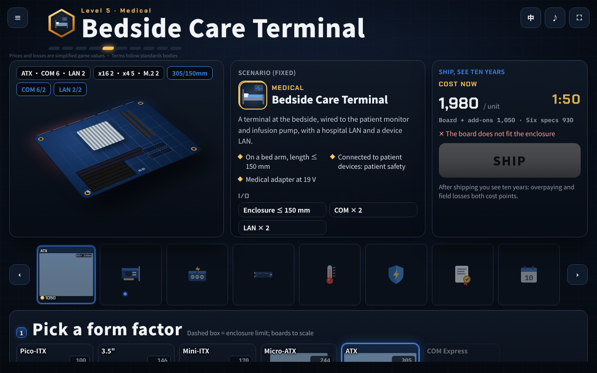

# Spec Quest · 選型大挑戰

A browser game about industrial-PC specs: ten industry scenarios, pick the board, fill the I/O, choose six spec grades. Buying more is waste, buying less becomes field losses later. Just enough scores 100.

工業電腦選型小遊戲：十個產業情境，選板型、補介面、挑六項規格。買多是浪費，買少是之後的現場損失，剛好才拿滿分。

## Play

Open `index.html` in any modern browser. No install, no build step, no server.
Progress is saved in the browser (localStorage).

## Publish on GitHub Pages

1. Create a repository and upload `index.html` plus the `bgm-*` audio files next to it (background music needs them).
2. Settings → Pages → Source: *Deploy from a branch* → Branch `main`, folder `/ (root)` → Save.
3. The game is live at `https://<your-account>.github.io/<repo>/`.

## Notes

- Terms follow PICMG, TIA, ISO, IEC and JEDEC. Prices, losses and board specs (port/slot counts, dimensions) are simplified game values, not real quotes or a 1:1 copy of any vendor's datasheet.
- Every level has exactly one best answer, verified by an exhaustive solver (`test_engine.mjs`).
- Source files: `engine.js` (rules, solver, scoring), `index.src.html` (UI), `build.mjs` (bundles into `index.html`).

## Music credits

All three tracks are MP3 only (re-encoded at a lower bitrate to keep the page light; the original OGG exports are not used due to a duration-metadata bug in the encoding toolchain).

- `bgm-practice.mp3` — a 35-second excerpt of "Exploration Theme" by Cleyton Kauffman ([soundcloud.com/cleytonkauffman](https://soundcloud.com/cleytonkauffman)), [CC0](https://opengameart.org/content/exploration-theme), cut at a natural quiet point for a clean loop. Title screen music. Attribution not required.
- `bgm-practice2.mp3` — "Cozy Puzzle In-Game 2" by MintoDog, [CC0](https://opengameart.org/content/cozy-puzzle-in-game-2). Practice-level music. Attribution not required.
- `bgm-formal.mp3` — "Tense Future Loop" by gmason, [CC0](https://opengameart.org/content/tense-future-loop). Formal-level music. Attribution not required.

## License

Copyright © AnChieh Tsai. All rights reserved.

The source code of this game (`index.src.html`, `index.html`, `engine.js`, `build.mjs`, `test_engine.mjs` and related files) is viewable on GitHub but is **not** licensed for reuse, modification or redistribution without the author's permission. The three `bgm-*.mp3` tracks are CC0 (public domain) under their original authors' terms — see Music credits above.

原始碼（`index.src.html`、`index.html`、`engine.js`、`build.mjs`、`test_engine.mjs` 及相關檔案）版權所有，公開於 GitHub 僅供瀏覽，未經作者同意不得重製、修改或散布。三首 `bgm-*.mp3` 音樂依原作者條款為 CC0（公共領域），詳見上方 Music credits。
